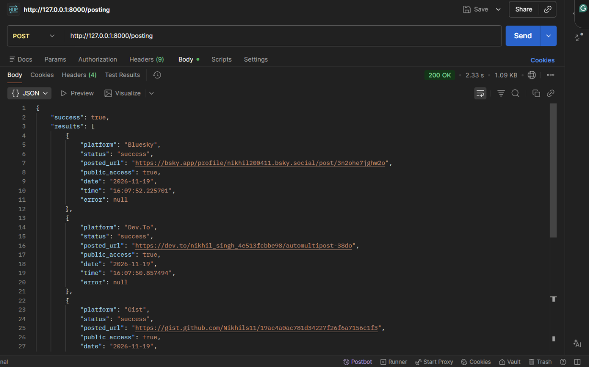
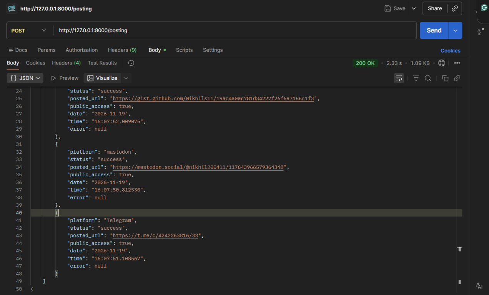

# Auto Multi Post

Auto Multi Post is a FastAPI service that publishes one message to Bluesky, Mastodon, DEV Community, GitHub Gist, and a Telegram channel.

> **Caution:** A request to the posting endpoint attempts to publish the message to every configured platform. Use test accounts or test content until you are ready to publish publicly.

## Requirements

- Python 3.13 or later
- [uv](https://docs.astral.sh/uv/) for dependency and environment management
- Credentials and account details for the platforms you want to use

## Setup

From the project directory, create the virtual environment and install the locked dependencies:

```shell
uv sync
```

Copy the sample environment file to the location read by the application:

**Windows PowerShell**

```powershell
Copy-Item app\.env.example app\.env
```

**macOS / Linux**

```shell
cp app/.env.example app/.env
```

Edit `app/.env` and replace the example values with your own credentials and account details. Keep this file private; it contains secrets and is excluded from Git. The application requires all listed settings, even if you do not plan to post to a particular platform.

## Run the API

Start the development server on the port specified by the practical test:

```shell
uv run uvicorn app.main:app --host 0.0.0.0 --port 4000 --reload
```

The API is available at `http://localhost:4000`. Open `http://localhost:4000/docs` for the interactive Swagger UI.

## Publish a message

Send a `POST` request to `/posting` with a JSON body containing a `message` of at most 200 characters. For example:

```shell
curl -X POST http://localhost:4000/posting \
  -H "Content-Type: application/json" \
  -d "{\"message\":\"Hello ji ki hal chal testing https://github.com/Nikhils11/Auto_multi_post\"}"
```

The message must be no more than 200 characters and contain exactly one valid HTTP or HTTPS URL. FastAPI returns a `422 Unprocessable Entity` response if the request body fails validation.

### Successful test response

This is the response returned for the request above during a successful test run:

```json
{
  "success": true,
  "results": [
    {
      "platform": "Bluesky",
      "status": "success",
      "posted_url": "https://bsky.app/profile/nikhil200411.bsky.social/post/3n2ohe7jghw2o",
      "public_access": true,
      "date": "2026-11-19",
      "time": "16:07:52.225701",
      "error": null
    },
    {
      "platform": "Dev.To",
      "status": "success",
      "posted_url": "https://dev.to/nikhil_singh_4e513fcbbe98/automultipost-38do",
      "public_access": true,
      "date": "2026-11-19",
      "time": "16:07:50.857494",
      "error": null
    },
    {
      "platform": "Gist",
      "status": "success",
      "posted_url": "https://gist.github.com/Nikhils11/19ac4a0ac781d34227f26f6a7156c1f3",
      "public_access": true,
      "date": "2026-11-19",
      "time": "16:07:52.009075",
      "error": null
    },
    {
      "platform": "mastodon",
      "status": "success",
      "posted_url": "https://mastodon.social/@nikhil200411/117643966579364348",
      "public_access": true,
      "date": "2026-11-19",
      "time": "16:07:50.812530",
      "error": null
    },
    {
      "platform": "Telegram",
      "status": "success",
      "posted_url": "https://t.me/c/4242263816/33",
      "public_access": true,
      "date": "2026-11-19",
      "time": "16:07:51.108567",
      "error": null
    }
  ]
}
```

The overall `success` value is `true` when at least one platform succeeds, and `false` if all platforms fail. Each platform's result reports its individual status.

### Successful run screenshots

The following screenshots show a successful local `POST /posting` request returning `200 OK` with successful results for Bluesky, DEV Community, GitHub Gist, Mastodon, and Telegram. They were captured with the local server running on port `8000`; the run command above uses the test-required port `4000`.





## Run tests

The project tests use Python's built-in `unittest` and do not make real platform API calls:

```shell
uv run python -m unittest discover -s tests -v
```

## Environment settings

The sample file is [`app/.env.example`](app/.env.example). It lists the settings required by the service:

| Setting | Purpose |
| --- | --- |
| `BLUESKY_USERNAME` | Bluesky account handle or identifier |
| `BLUESKY_PASSWORD` | Bluesky password or app password |
| `BLUESKY_DID` | Bluesky repository DID |
| `BLUESKY_SESSION_URL` | Bluesky session creation endpoint |
| `BLUESKY_POST_URL` | Bluesky record creation endpoint |
| `BLUESKY_MESSAGE_URL` | Base URL used to construct the posted Bluesky web link |
| `MASTODON_USERNAME` | Mastodon account name used when constructing the post URL |
| `MASTODON_ACCESS_TOKEN` | Mastodon access token |
| `MASTODON_POST_URL` | Status creation endpoint for your Mastodon instance |
| `DEVTO_USERNAME` | DEV Community username |
| `DEVTO_API_KEY` | DEV Community API key |
| `DEVTO_POST_URL` | DEV Community article creation endpoint |
| `GIST_PAT_TOKEN` | GitHub personal access token with permission to create Gists |
| `GIST_POST_URL` | GitHub Gist creation endpoint |
| `TELEGRAM_API_TOKEN` | Telegram bot token |
| `TELEGRAM_BASE_URL` | Telegram Bot API base URL |
| `TELEGRAM_CHANNEL_URL` | Public channel URL prefix used to construct post links |
| `TELEGRAM_CHANNEL_ID` | Telegram channel ID or username the bot will post to |

Use the endpoint URLs and account-specific values appropriate for your accounts and instances. The values in the sample are examples, not working credentials.
